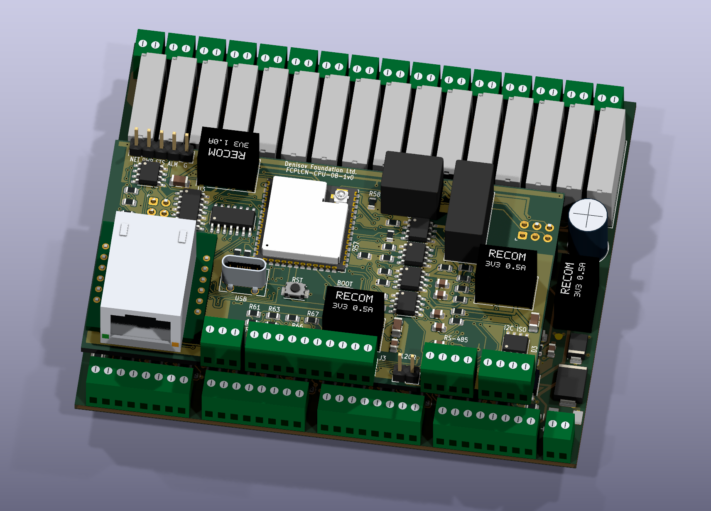
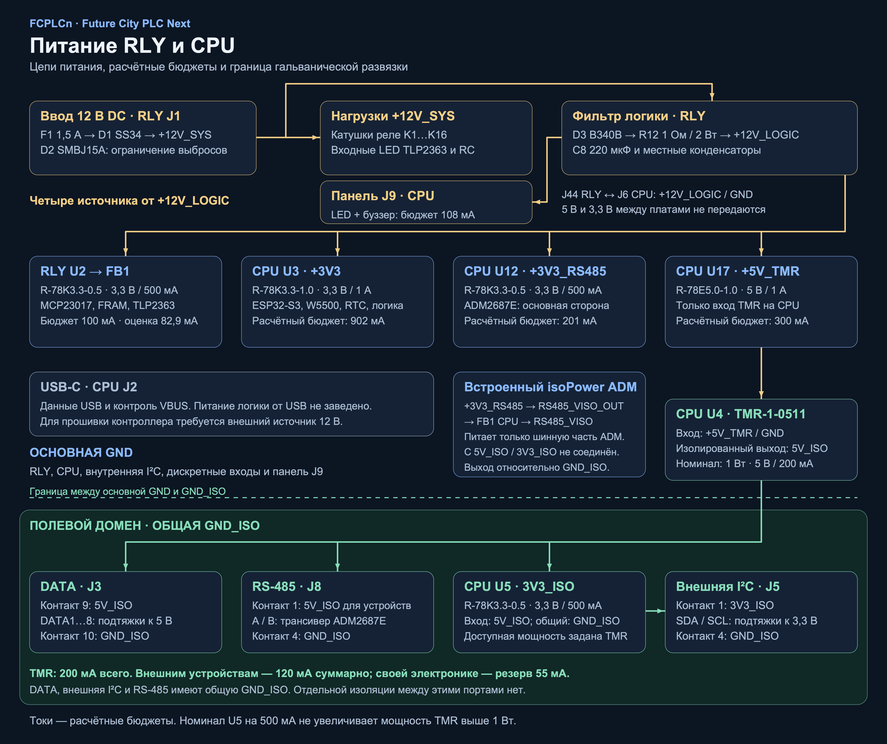
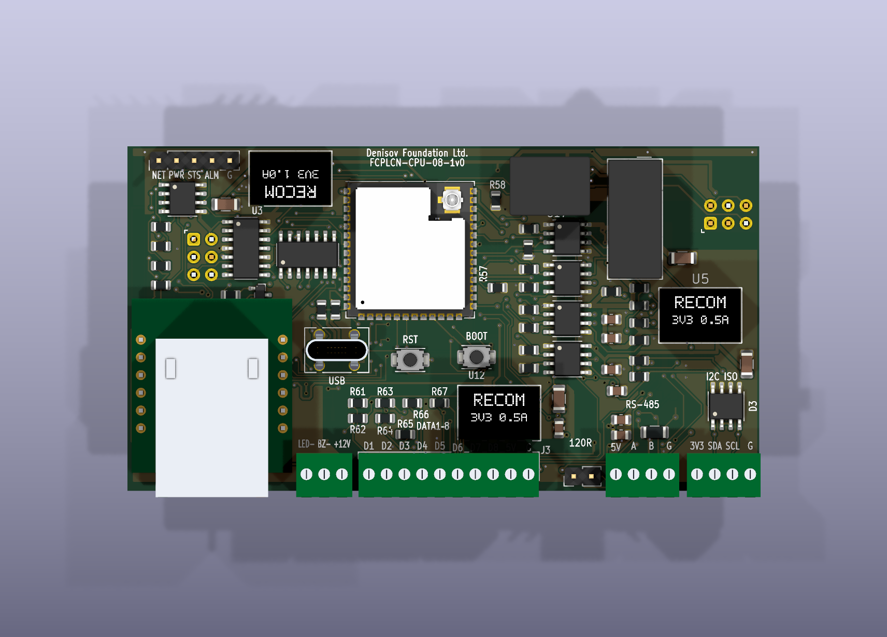
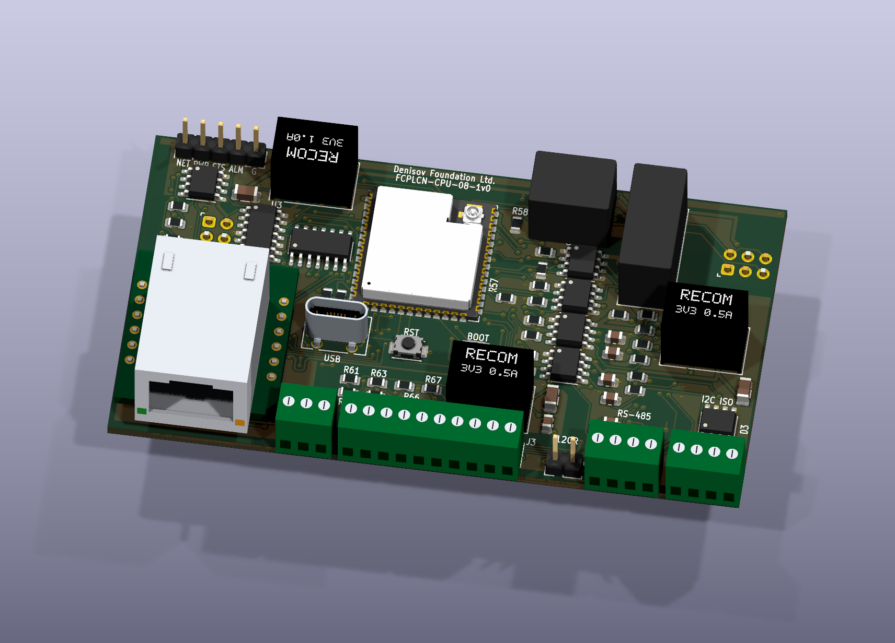
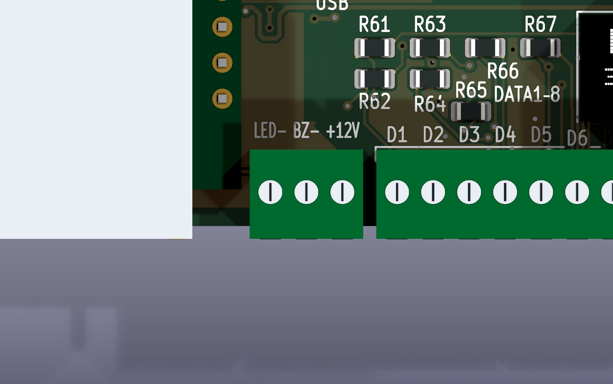
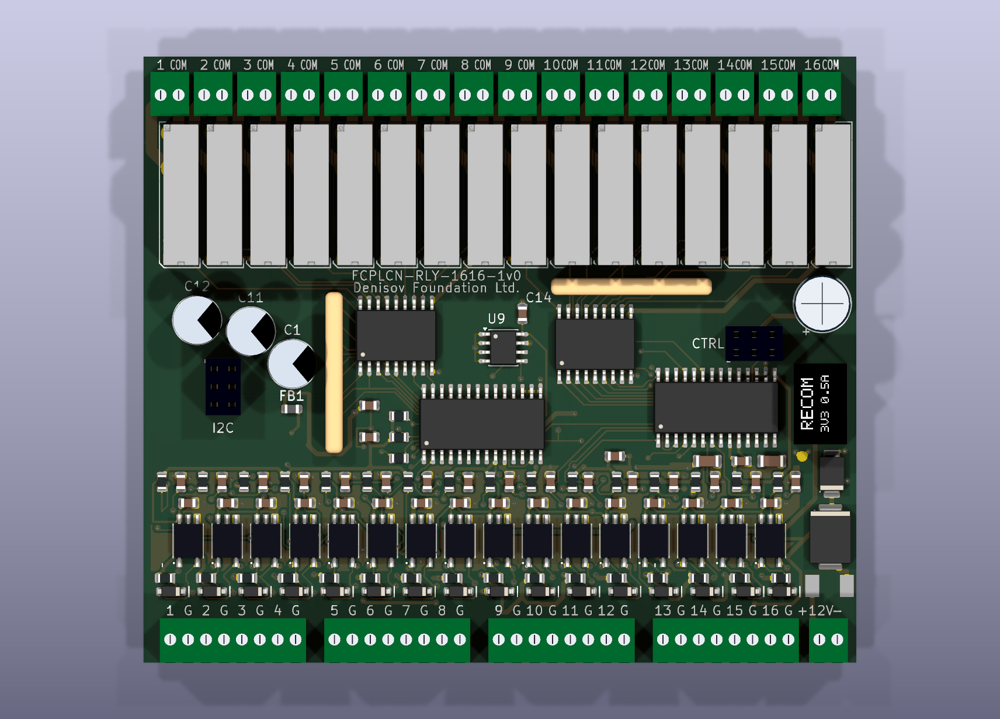
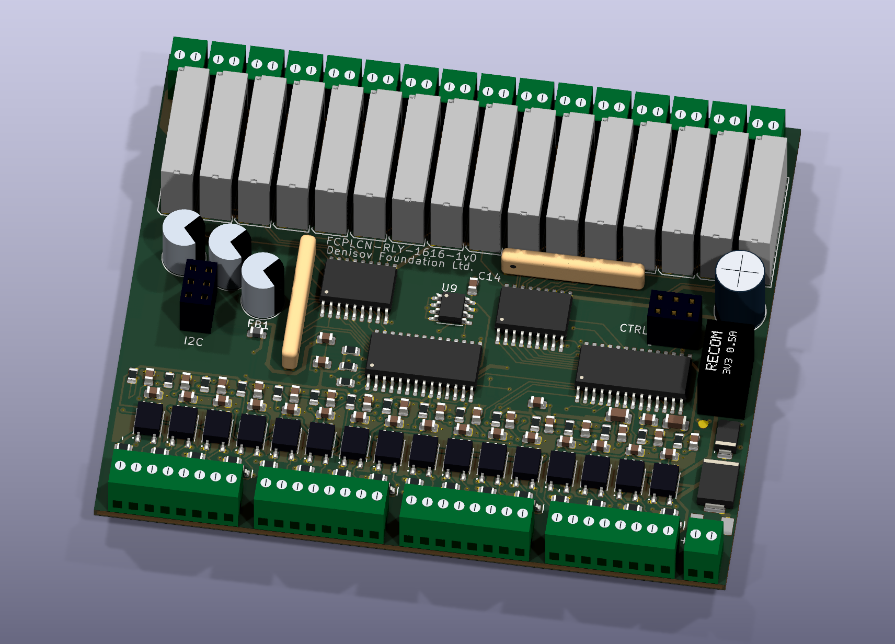

# FCPLCN-161608-1v0

**FCPLCn — Future City PLC Next.** Двухплатный комплект:
16 реле, 16 дискретных входов, 8 DATA-линий и выходы LED/буззера iButton-панели.

Подробное актуальное описание, питание, GPIO и распиновки:
**[основной README репозитория](../README.md)**.

## Платы и исходники

| Плата                      | Проект KiCad                                                | Принципиальная схема                                       | Читаемый PDF                                  |
| -------------------------- | ----------------------------------------------------------- | ---------------------------------------------------------- | --------------------------------------------- |
| Верхняя CPU, 90,5 × 49,44 мм | [Проект](FCPLCN-CPU-08-1v0/FCPLCN-CPU-08-1v0.kicad_pro)     | [KiCad](FCPLCN-CPU-08-1v0/FCPLCN-CPU-08-1v0.kicad_sch)     | [PDF](FCPLCN-CPU-08-1v0/FCPLCN-CPU-08-1v0-schematic.pdf)   |
| Нижняя RLY, 101 × 86 мм    | [Проект](FCPLCN-RLY-1616-1v0/FCPLCN-RLY-1616-1v0.kicad_pro) | [KiCad](FCPLCN-RLY-1616-1v0/FCPLCN-RLY-1616-1v0.kicad_sch) | [PDF](FCPLCN-RLY-1616-1v0/FCPLCN-RLY-1616-1v0-schematic.pdf) |

CPU содержит ESP32-S3-WROOM-1U-N16R8, W5500-Lite, RTC DS3231MZ+,
полевые DATA/I²C и трансивер RS-485 ADM2687E. На нижней плате расположены
реле HF49FD/012-1H11, входные TLP2363 с RC-фильтрами, два MCP23017
и FRAM FM24CL64B-GTR на 8192 байта.

Текущая комплектация: **CPU 164 + RLY 248 = 412** покупных деталей;
батарейка **CR1220 3 В** покупается отдельно. Обе платы двухслойные, 1,6 мм.
Две штатные пары межплатных разъёмов передают питание, I²C и RESET MCP.
Дополнительные механические пары удалены из текущих исходников.

## Питание двух плат

**12 В DC** подаются на нижний **J1**. После предохранителя **F1 1,5 А**
и диода **D1 SS34** получается `+12V_SYS`; **D2 SMBJ15A** ограничивает
кратковременные выбросы, C1/C11/C12 образуют банк 300 мкФ / 35 В.
Эта ветка питает катушки реле и светодиодные входные цепи TLP2363.
Сухие COM/NO контакты коммутируют внешнюю нагрузку, собственных 12 В на них нет.

Ветка электроники отделена фильтром:
`+12V_SYS → D3 B340B → R12 1 Ом → +12V_LOGIC`,
с C8 220 мкФ и C13 100 нФ после R12. Защищённые `+12V_LOGIC`
питают четыре местных импульсных преобразователя без гальванической изоляции:

| Плата и модуль | Питает | Номинал выхода | Выделено по расчёту |
| --- | --- | --- | --- |
| **RLY U2 R-78K3.3-0.5** | Через **FB1 BLM21PG221SN1D** — местные 3,3 В MCP23017, FRAM и выходных сторон TLP2363 | **3,3 В / 500 мА** | **100 мА**, компонентная оценка **82,9 мА** |
| **CPU U3 R-78K3.3-1.0** | ESP32-S3, W5500, RTC, основные стороны изоляторов и обвязка | **3,3 В / 1 А** | **902 мА** |
| **CPU U12 R-78K3.3-0.5** | Основная сторона ADM2687E, буфер и подтяжки | **3,3 В / 500 мА** | **201 мА** |
| **CPU U17 R-78E5.0-1.0** | Только вход TMR U4, местная `+5V_TMR` | **5 В / 1 А** | **300 мА** |

На RLY C3/C6 находятся до FB1, C7 и местные 100 нФ — после него;
нижний линейник U8 удалён. Питание между платами передаётся только как **12 В и GND**:
правый J44/J6 — питание и RESET, левый J43/J1 — I²C и GND.
Контакты 1–4 левой пары — GND. Шины **5 В и 3,3 В между платами не передаются**.

На CPU `+5V_TMR → U4 TMR-1-0511 → +5V_ISO / GND_ISO` —
изолированное питание поля **5 В / 200 мА, всего 1 Вт**.
Оно поступает на **J3.9 DATA**, **J8.1 RS-485** и полевые стороны DATA-изоляторов.
От этой же шины **U5 R-78K3.3-0.5** формирует `+3V3_ISO` для **J5.1 I²C**
и полевой стороны её изолятора. U5 имеет номинал 500 мА, но доступная мощность
ограничена общим TMR. На собственную полевую электронику выделено 55 мА
в эквиваленте 5 В, на все внешние устройства — **120 мА суммарно**;
общий бюджет поля — 175 из 200 мА. Это общий лимит DATA/I²C/RS-485,
а не отдельный лимит каждого разъёма.

Встроенный **isoPower ADM2687E** отдельно питает только шинную сторону
самого трансивера: `VISOOUT10 → CPU FB1 → VISOIN15`.
Он не соединён с `+3V3_ISO`; питание на J8 приходит от TMR.
DATA, внешняя I²C и шинная сторона RS-485 имеют общую **GND_ISO**,
без изоляции портов друг от друга. Основная **GND** объединяет CPU и RLY.

LED/буззер панели питаются от `+12V_LOGIC` через **CPU F2 PTC и D11 SS14**
на `+12V_PANEL / J9`; ULN2001 управляет их минусами относительно основной GND.
Бюджет панели — **108 мА**. CR1220 резервирует только RTC; зарядной цепи нет.
**USB VBUS используется только для контроля на GPIO21** и не питает платы:
для работы и прошивки через USB нужны внешние **12 В**.

Все токи — расчётные бюджеты, не измеренные максимумы. Для входа TMR при 1 Вт
и типовом КПД 76% получается 263,158 мА; выделено 300 мА.
Модель всего комплекта даёт около **0,995–1,012 А от 12 В**.
Подробности и допущения — [основное описание питания](../README.md#power),
[бюджет](Power-budget.json) и [расчёт](Power-split-design-review.json).

## CPU сверху и подключение iButton-панели

Клеммник **J9, KF128-2.54-3P**, находится на нижнем переднем краю CPU-платы
между Ethernet и DATA. На виде сверху контакты идут слева направо:

| Контакт | Надпись | Подключение |
| ------- | ------- | ----------- |
| 1 | **LED−** | Катод LED; GPIO43 через ULN2001 |
| 2 | **BZ−** | Минус буззера; GPIO45 через ULN2001 |
| 3 | **+12V** | Общий плюс LED и буззера |

HIGH включает соответствующую нагрузку. Резистор LED **1 кОм / 0,5 Вт**
установлен на CPU-плате; ток LED около **6–8 мА**, расчётный ток буззера —
до **100 мА**. Это номинальная 12-вольтовая ветка: при полной расчётной
нагрузке напряжение на буззере может снизиться примерно до **8,5–9 В**.
При загрузке GPIO43 используется ROM UART0 TX, поэтому LED может мигать или гореть.

Сам сокет ключа подключается отдельно к выбранной **DATA на J3 и GND_ISO**.
J9 обслуживает свет и звук и не содержит отдельного GND. Контакты сокета
не соединяются с цепями LED/буззера и основной GND внутри панели.

## Нижняя RLY сверху и под наклоном

## Проверка изготовления CPU

[Текущий отчёт](Power-split-validation.json) связывает исходники с проверками соединений, производственных зазоров, изоляции, USB и механики. Параметры — [профиль завода](Power-split-profile.json). Локальные переходы с кольцом 0,15 мм и посадка DIP USB-C используют опубликованные предельные возможности производства; обычное кольцо — 0,20 мм. Для ручной сборки учтите [список отверстий под предварительное заполнение припоем](Power-split-via-prefill-CPU.csv) и [заметки сборки](ASSEMBLY.md).

## Документация и материалы

- [Общий BOM](BOM-combined.csv).
- Схемы PDF: [CPU](FCPLCN-CPU-08-1v0/FCPLCN-CPU-08-1v0-schematic.pdf), [RLY](FCPLCN-RLY-1616-1v0/FCPLCN-RLY-1616-1v0-schematic.pdf). Схемы SVG/PNG находятся в каталогах соответствующих плат.
- [Галерея ракурсов](Previews/native-all-views/index.html) — открыть локально после скачивания.
- [Архив KiCad](FCPLCN-161608-1v0-KiCad.zip).
- [Архив 3D-видов](FCPLCN-161608-1v0-3D-views.zip).
- [Заметки сборки и предшествующие изменения](ASSEMBLY.md).
- [Текущий бюджет питания](Power-budget.json).
- [Геометрия сборки](Stack-mechanics.json).
- [Актуальный отчёт с контрольными суммами](Power-split-validation.json).
- [Инструменты аппаратных проверок](tools/README.md).
- [История аппаратных операций](CHANGELOG.md).

Локальные библиотеки, посадочные места и 3D-модели следует сохранять рядом
с платами: пути используют `${KIPRJMOD}`. Стандартные библиотеки KiCad 10
устанавливаются отдельно. `Manufacturing-validation.json` описывает предыдущую CPU-ревизию с SHA `5ba899b9…`;
текущую ревизию подтверждает `Power-split-validation.json`. Старые отчёты подтверждают только собственные
контрольные суммы; актуальные номиналы и количество деталей приведены
в основном README, BOM и текущих исходниках.
