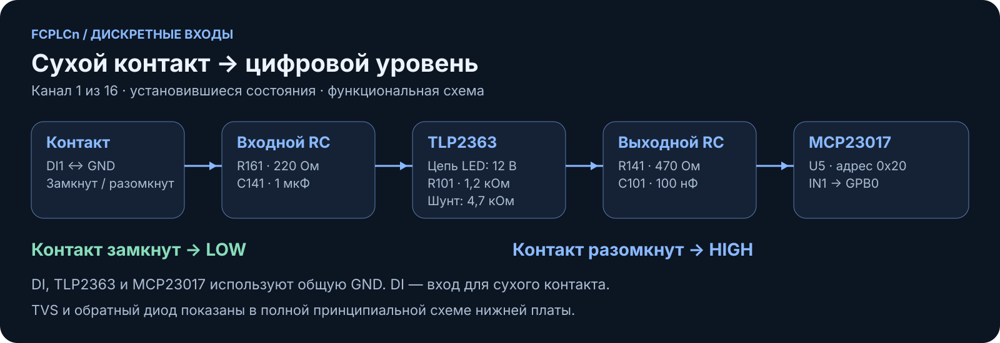
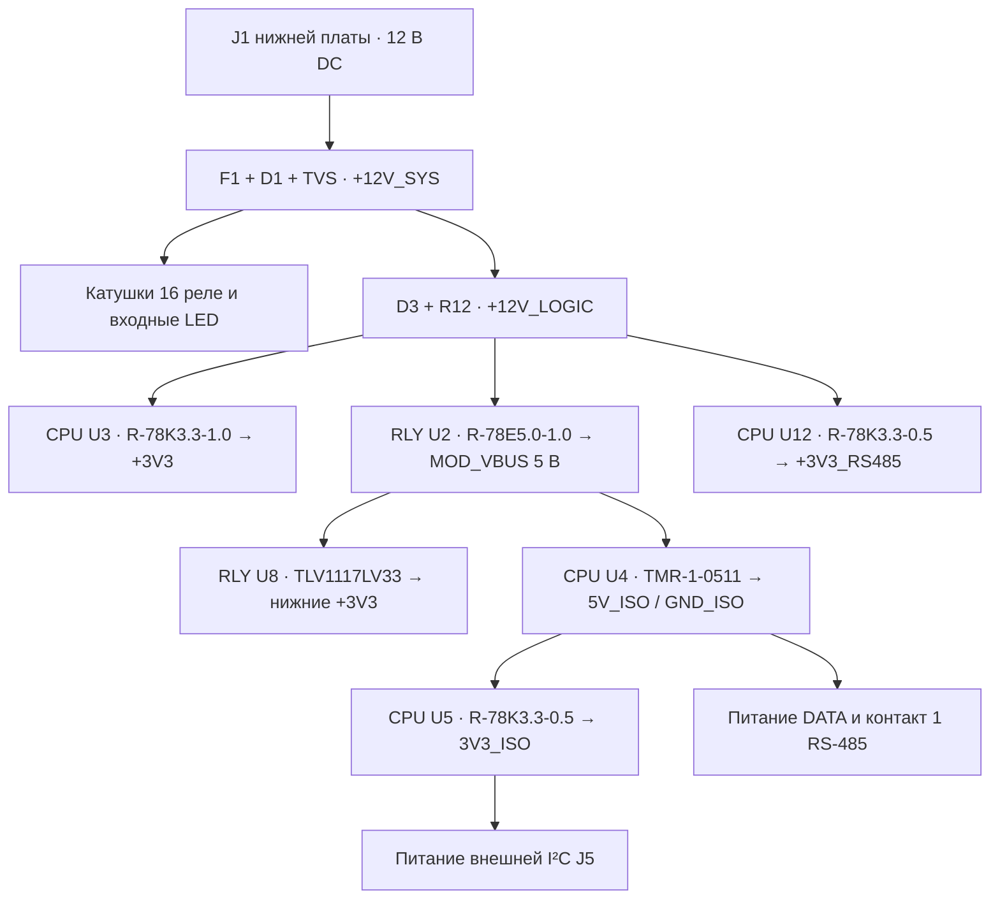
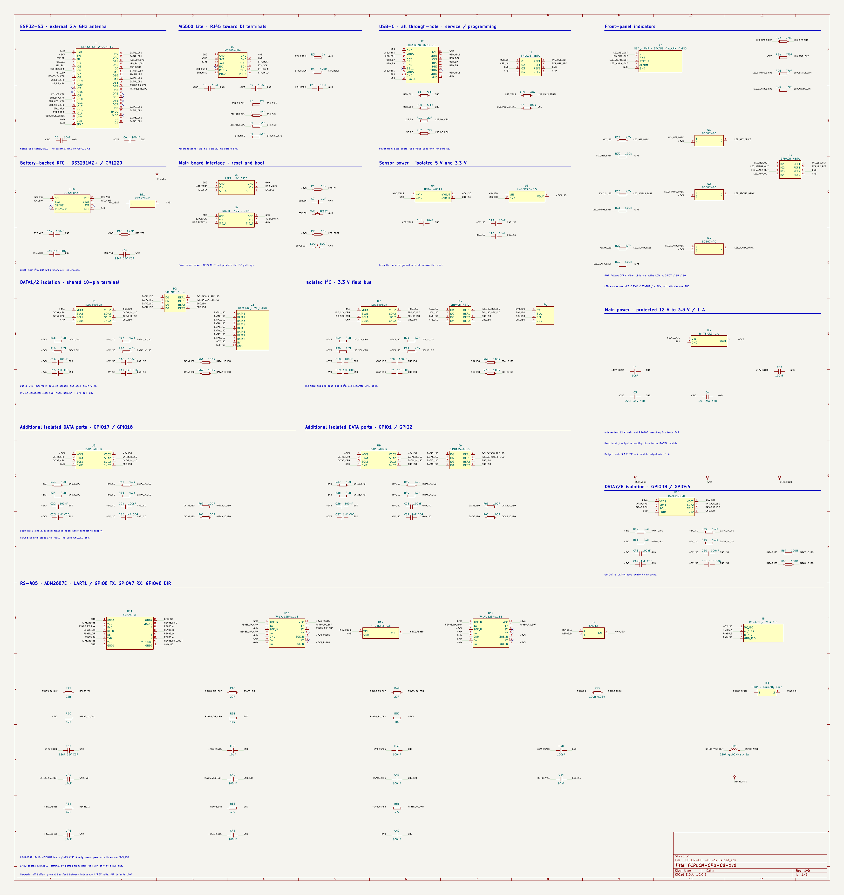
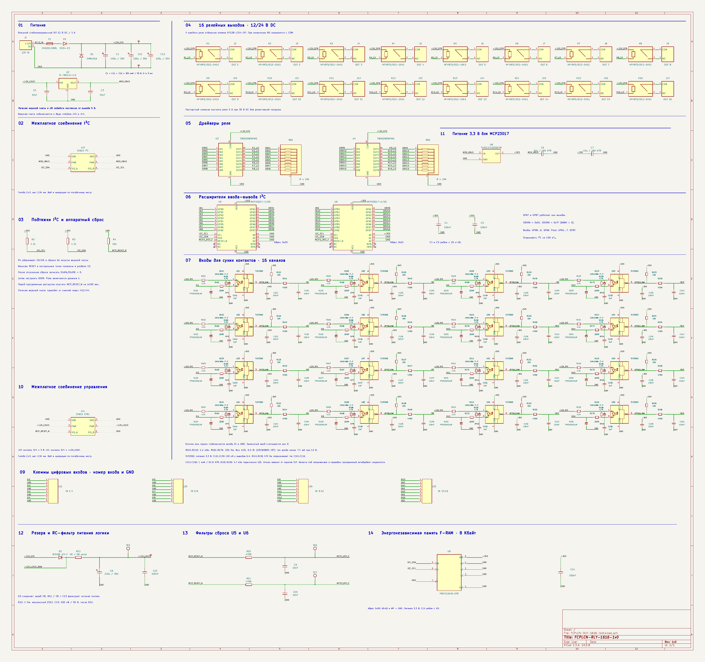
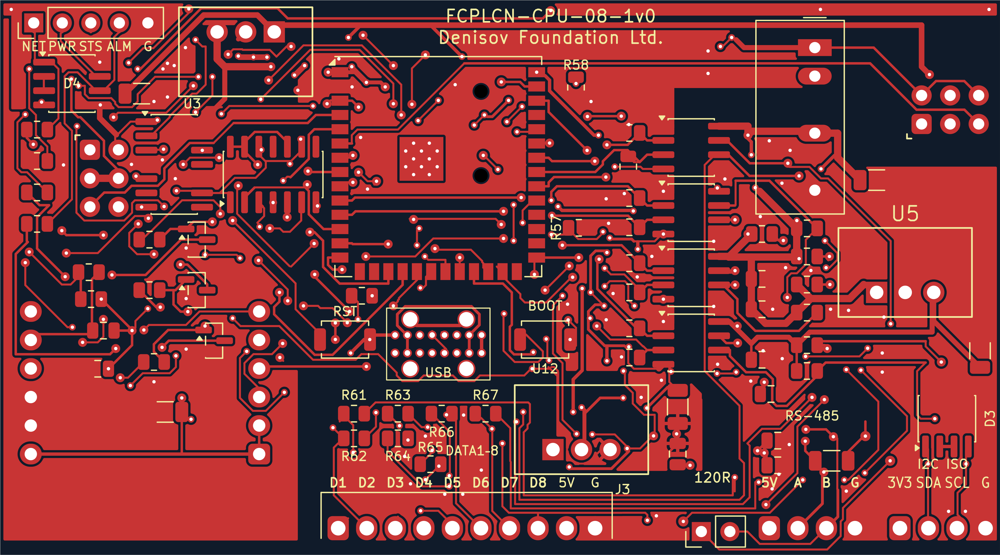
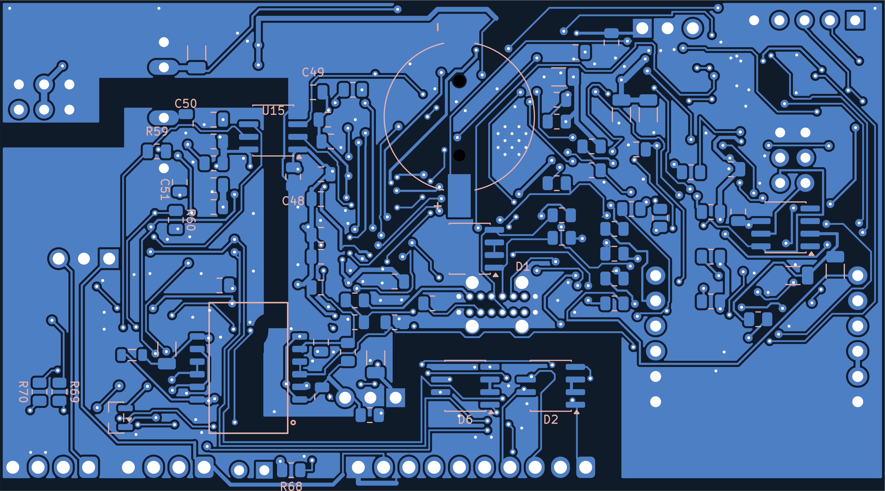

# FCPLCn — платы контроллера

**Future City PLC Next · FCPLCN-161608-1v0**

**16 реле · 16 дискретных входов · 8 DATA-линий · Ethernet · Wi-Fi · RS-485**

Двухплатный PLC для локальной автоматики квартиры, частного дома и дачи.
Верхняя плата содержит процессор, сетевые интерфейсы, часы и полевые порты.
Нижняя — реле, входы, расширители GPIO, энергонезависимую FRAM и вход питания.
Прошивка выполняет местную логику управления, а Linux-хаб объединяет несколько PLC
в общий умный дом.

[](docs/readme/stack-overview.png)

<p align="center">
  <a href="#overview">Характеристики</a> ·
  <a href="#cpu">CPU-плата</a> ·
  <a href="#relay">Реле и входы</a> ·
  <a href="#ports">Разъёмы и GPIO</a> ·
  <a href="#power">Питание</a> ·
  <a href="#schematics">Схемы</a> ·
  <a href="#files">Файлы проекта</a>
</p>

Рендеры показывают конструкцию комплекта. Характеристики ниже сверены с текущими
схемами, нетлистами и BOM; токи обозначены как расчётные бюджеты.
Подробная аппаратная квалификация образца остаётся отдельным этапом.

<a id="overview"></a>

## Комплект FCPLCN-161608-1v0

| Узел              | Исполнение                                                               |
| ----------------- | ------------------------------------------------------------------------ |
| Верхняя плата     | **FCPLCN-CPU-08-1v0**, 89 × 49,44 мм                                     |
| Нижняя плата      | **FCPLCN-RLY-1616-1v0**, 101 × 86 мм                                     |
| Процессор         | ESP32-S3-WROOM-1U-N16R8, внешняя антенна 2,4 ГГц                         |
| Память процессора | 16 МиБ Flash и 8 МиБ PSRAM                                               |
| Релейные выходы   | 16 независимых нормально разомкнутых пар **COM/NO**                      |
| Дискретные входы  | 16 входов для сухого контакта с TLP2363 и RC-фильтрами                   |
| DATA              | 8 линий через ISO1640 для интерфейсов с открытым стоком                  |
| Сеть              | Wi-Fi ESP32-S3 и Ethernet на W5500-Lite / USR-ES1                        |
| RS-485            | ADM2687EBRIZ, полудуплекс, управление направлением через GPIO            |
| Часы              | DS3231MZ+, резервирование от **CR1220 3 В**                              |
| FRAM              | FM24CL64B-GTR, **8192 байта**, на нижней плате                           |
| Питание комплекта | Внешние **12 В DC**, ввод на нижней плате                                |
| Технология PCB    | Обе платы двухслойные, толщина 1,6 мм                                    |
| Спецификация      | CPU **148** + RLY **248** = **396** покупных деталей; батарейка отдельно |

Числа `16 / 16 / 08` в обозначении комплекта соответствуют реле, дискретным входам
и DATA-линиям. Это одна аппаратная конфигурация с двумя физическими платами.

### Как связаны платы

[](docs/readme/hardware-architecture.svg)

Внутренняя I²C соединяет ESP32-S3, два MCP23017, FRAM и RTC. Отдельная линия
сбрасывает расширители GPIO. Межплатные разъёмы передают также 5 В, 12 В и GND.
Внешние DATA, I²C и RS-485 отделены от основной логики барьером, но используют
**общую `GND_ISO`**. Дискретные входы относятся к основной GND.

<a id="cpu"></a>

## Верхняя плата — FCPLCN-CPU-08-1v0

CPU-плата отвечает за автономную логику PLC, подключение к локальной сети,
чтение полевых датчиков и сервисный USB. ESP32-S3 установлен в исполнении
с разъёмом внешней антенны. W5500 подключён по SPI; разъём RJ45 расположен
у переднего края сборки.

На обратной стороне находятся RTC, держатель батарейки и часть обвязки:

[](docs/readme/cpu-bottom.png)

| Обозначение  | Компонент                | Назначение                                     |
| ------------ | ------------------------ | ---------------------------------------------- |
| U1           | ESP32-S3-WROOM-1U-N16R8  | Контроллер, Wi-Fi, Flash и PSRAM               |
| U2           | W5500-Lite / USR-ES1     | Проводной Ethernet по SPI                      |
| U3           | R-78K3.3-1.0             | Основное питание CPU 3,3 В                     |
| U4           | TMR-1-0511               | Изолированное питание 5 В, всего 1 Вт          |
| U5           | R-78K3.3-0.5             | Полевое питание `3V3_ISO`                      |
| U6/U8/U9/U15 | ISO1640BDR               | Восемь DATA-линий, по две на микросхему        |
| U7           | ISO1640BDR               | Внешняя I²C на J5                              |
| U10 / BT1    | DS3231MZ+ / Q&J CR1220-2 | Часы и резервная батарейка                     |
| U11          | ADM2687EBRIZ             | Изолированный трансивер RS-485                 |
| U12          | R-78K3.3-0.5             | Отдельное основное питание RS-485 3,3 В        |
| U13/U14      | Nexperia 74LVC125AD,118  | Буферы сигналов между основными цепями питания |

### DATA и внешняя I²C

J3 выводит восемь DATA-линий, питание `5V_ISO` и `GND_ISO`. Это линии
с открытым стоком: в аппаратном профиле они соответствуют `sens-0/1`…`sens-0/8`.
Они предусмотрены для трёхпроводных OneWire/DHT22-подключений с отдельным питанием.
Полевые подтяжки DATA подключены к **5 В**.

J5 — отдельная внешняя I²C: `3V3_ISO`, SDA, SCL, `GND_ISO`.
Её сигналы подтянуты к **3,3 В**. Она использует другую пару GPIO, чем внутренняя
шина расширителей и памяти. Устройства на J5 не занимают адреса внутренней I²C.

### RS-485

J8 содержит `5V_ISO`, A/D+, B/D− и `GND_ISO`. GPIO48 управляет направлением:
HIGH — передача, LOW — приём. Терминатор **120 Ом** включается перемычкой JP2,
расположенной спереди между J3 и J8 рядом с надписью `120R`.

Питание 5 В на J8 поступает от общего полевого TMR. Внутренний источник isoPower
ADM2687E обслуживает сам трансивер и не является источником питания DATA/I²C.
Конкретный протокол RS-485 задаётся программным обеспечением; наличие трансивера
не означает автоматическую поддержку любого протокола.

### RTC и USB

DS3231MZ+ находится на внутренней I²C по адресу **`0x68`**. Батарейка —
**CR1220 3 В**, держатель Q&J CR1220-2, LCSC C70381; покупается отдельно.
FRAM имеет самостоятельное энергонезависимое хранение и батарейки не требует.

USB-C J2 используется для штатного USB Serial/JTAG ESP32-S3. D−/D+ подключены
к GPIO19/20, VBUS контролируется через GPIO21. **Для работы и прошивки через USB
нужно штатное питание 12 В:** USB VBUS служит сигналом контроля и не питает платы.
На плате доступны кнопки RESET и BOOT.

<a id="relay"></a>

## Нижняя плата — FCPLCN-RLY-1616-1v0

Нижняя плата объединяет шестнадцать реле, шестнадцать дискретных входов,
два MCP23017, FRAM и питание всего комплекта. Верхний ряд клемм — выходные
контакты реле, нижний — входы DI с соседними GND; справа расположен ввод 12 В.

[](docs/readme/relay-top.png)

### Реле

K1…K16 — **HF49FD/012-1H11** с катушками 12 В. Каждый канал имеет свою пару
COM/NO на отдельном клеммнике J2…J17. Силовые COM разных каналов внутри платы
не объединены. U3/U4 **TBD62083AFWG** управляют катушками, а RN1/RN2 задают
подтяжки управляющих линий к GND.

```text
Реле выключено:  COM  o     o  NO
Реле включено:   COM  o─────o  NO

MCP23017 → TBD62083AFWG → катушка K1…K16
```

При сборке допустимая нагрузка определяется всем трактом: контактами выбранного
реле, дорожками, клеммами и проводкой. Число каналов не задаёт допустимый ток
силовой части.

### Дискретные входы

J21/J25/J29/J33 принимают четыре группы по четыре сухих контакта.
У каждого DI рядом расположен GND. Состояния на стороне MCP23017:

| Контакт между DI и GND | Уровень входа |
| ---------------------- | ------------- |
| Разомкнут              | **HIGH**      |
| Замкнут                | **LOW**       |

[](docs/readme/input-channel.svg)

Каждый канал содержит TLP2363, входной TVS, обратный диод и две ступени фильтрации.
В текущей ревизии входная цепь использует **1,2 кОм**, последовательные **220 Ом**,
ёмкость **1 мкФ** и шунт LED **4,7 кОм**. На выходе остаются **470 Ом / 100 нФ**
и внешняя подтяжка RAW-сигнала **10 кОм**. Внутренние подтяжки MCP23017 отключены.

Цепь LED питается от внутренних 12 В. DI рассчитан на замыкание сухим контактом;
его нельзя трактовать как свободный GPIO 3,3 В. **Земля DI общая с логикой**:
TLP2363 здесь не образуют отдельный гальванически изолированный домен входов.
Примеры назначений — возвратная кнопка, геркон или релейный выход датчика.

### Расширители и FRAM

U5/U6 **MCP23017** обслуживают по восемь реле и восемь входов.
Обозначения портов MCP повторяются на каждой микросхеме:

| Номер в группе | Реле      | Дискретный вход |
| -------------- | --------- | --------------- |
| 1…7            | GPA1…GPA7 | GPB0…GPB6       |
| 8              | GPB7      | GPA0            |

U5 соответствует каналам **1…8**, U6 — **9…16**. Маска выходов — `0x80FE`,
входов — `0x7F01`. Аппаратный RESET расширителей приходит с CPU GPIO6;
INTA/INTB не подключены.

U9 **FM24CL64B-GTR** хранит 8192 байта без питания. A0/A1/A2 подключены к GND,
поэтому адрес — `0x50`; WP также на GND, запись разрешена. Память подключена
к той же внутренней шине, что расширители и RTC. В прошивке она используется
для сохранения оперативных состояний оборудования.

| Внутренняя I²C · GPIO4/5 | Адрес, 7 бит | Размещение                |
| ------------------------ | ------------ | ------------------------- |
| MCP23017 U5              | `0x20`       | Нижняя плата, каналы 1…8  |
| MCP23017 U6              | `0x21`       | Нижняя плата, каналы 9…16 |
| FRAM FM24CL64B-GTR U9    | `0x50`       | Нижняя плата              |
| RTC DS3231MZ+ U10        | `0x68`       | Верхняя плата             |

<a id="ports"></a>

## Разъёмы и аппаратные имена

**Нумерация ниже — номера контактов в KiCad**, а не направление слева направо
на произвольно повёрнутом рендере. Первый контакт сверяется по исходнику и
маркировке конкретного разъёма.

| Плата / разъём | Назначение         | Контакты по номерам                                     |
| -------------- | ------------------ | ------------------------------------------------------- |
| RLY · J1       | Питание комплекта  | 1 — +12 В DC; 2 — GND                                   |
| RLY · J2…J17   | Реле 1…16          | 1 — COM; 2 — NO                                         |
| RLY · J21      | Входы 1…4          | Нечётные 1/3/5/7 — DI1/2/3/4; чётные — GND              |
| RLY · J25      | Входы 5…8          | Нечётные 1/3/5/7 — DI5/6/7/8; чётные — GND              |
| RLY · J29      | Входы 9…12         | Нечётные 1/3/5/7 — DI9/10/11/12; чётные — GND           |
| RLY · J33      | Входы 13…16        | Нечётные 1/3/5/7 — DI13/14/15/16; чётные — GND          |
| CPU · J3       | DATA, 10 контактов | 1…8 — DATA1…8; 9 — 5V_ISO; 10 — GND_ISO                 |
| CPU · J5       | Внешняя I²C        | 1 — 3V3_ISO; 2 — SDA_ISO; 3 — SCL_ISO; 4 — GND_ISO      |
| CPU · J8       | RS-485             | 1 — 5V_ISO; 2 — A/D+; 3 — B/D−; 4 — GND_ISO             |
| CPU · J7       | Передняя индикация | 1 — NET; 2 — PWR; 3 — STATUS; 4 — ALARM; 5 — GND        |
| CPU · J2       | Сервисный USB-C    | USB D−/D+, VBUS sense; внешнее питание 12 В сохраняется |

### Две штатные межплатные пары

Нижние гнёзда — Samtec **SSW-103-01-L-D**, верхние гребёнки —
**TSW-103-07-L-D**. У каждой пары шесть контактов, всего между платами их двенадцать.

| Контакт | Нижний J43 ↔ верхний J1 | Нижний J44 ↔ верхний J6 |
| ------- | ----------------------- | ----------------------- |
| 1       | GND                     | GND                     |
| 2       | GND                     | GND                     |
| 3       | MOD_VBUS, 5 В           | +12V_LOGIC              |
| 4       | MOD_VBUS, 5 В           | +12V_LOGIC              |
| 5       | I2C_SDA, GPIO4          | MCP_RESET_N, GPIO6      |
| 6       | I2C_SCL, GPIO5          | GND                     |

Обозначения J1 и J6 здесь относятся к CPU; RLY J1 — отдельный ввод питания.
В текущей CAD-ревизии дополнительных механических пар разъёмов нет.

### GPIO ESP32-S3

| Назначение                   | GPIO                             |
| ---------------------------- | -------------------------------- |
| Внутренняя I²C SDA / SCL     | **4 / 5**                        |
| RESET MCP23017               | **6**                            |
| W5500 CS / SCK / MOSI / MISO | **9 / 10 / 11 / 12**             |
| W5500 INT_N / RESET_N        | **13 / 14**                      |
| USB D− / D+ / VBUS sense     | **19 / 20 / 21**                 |
| RS-485 TX / RX / DIR         | **8 / 47 / 48**                  |
| Внешняя I²C SDA / SCL        | **41 / 42**                      |
| DATA1…DATA8                  | **39, 40, 17, 18, 1, 2, 38, 44** |
| NET / STATUS / ALARM         | **7 / 15 / 16**, активный LOW    |
| BOOT                         | **0**                            |

PWR показывает основное питание 3,3 В. GPIO35–37 оставлены неподключёнными
для варианта N16R8 с Octal PSRAM. GPIO44 уже используется DATA8.

В профиле прошивки каналы имеют имена `rly-0/1`…`rly-0/16`,
`in-0/1`…`in-0/16` и `sens-0/1`…`sens-0/8`.
[Профиль аппаратуры в fcplcn-soft](https://github.com/LittleBuster/fcplcn-soft/blob/main/firmware/base/main/hardware/board_profile.cpp).

<a id="power"></a>

## Питание и домены земли



На вводе установлены предохранитель **1,5 А**, диод SS34 и TVS SMBJ15A.
Ветка логики отделена D3 и R12 от питания катушек.

| Ветка                           | Расчётный бюджет / ограничение                                 |
| ------------------------------- | -------------------------------------------------------------- |
| Основные 3,3 В CPU              | **890 мА**, модуль U3 на 1 А                                   |
| Общие 5 В                       | **363,258 мА**, модуль нижней U2 на 1 А                        |
| Нижние 3,3 В                    | **82,5 мА** компонентная оценка; выделено **100 мА**           |
| Основные 3,3 В RS-485           | **201 мА**, модуль U12 на 500 мА                               |
| Полевой источник TMR            | **1 Вт / 5 В / 200 мА всего**                                  |
| Внешние полевые устройства      | **120 мА суммарного проектного лимита** на все DATA/I²C/RS-485 |
| Собственная полевая электроника | Резерв **55 мА** в эквиваленте нагрузки 5 В                    |
| Полевая ветка вместе            | **175 из 200 мА**, резерв 25 мА                                |
| Весь комплект по входу 12 В     | **0,873–0,890 А** по текущей расчётной модели                  |

120 мА — общий бюджет внешних устройств с учётом обеих полевых шин питания,
а не отдельный бюджет на каждом разъёме. Номинал 500 мА стабилизатора `3V3_ISO`
не увеличивает мощность TMR выше 1 Вт. Источник и условия расчёта:
[Power-budget.json](FCPLCN-161608-1v0/Power-budget.json).

**Основная GND** объединяет CPU, MCP23017, FRAM, RTC и дискретные входы.
**GND_ISO** объединяет DATA, внешнюю I²C и полевую сторону RS-485.
Изоляция между этими двумя доменами сохраняется при соответствующем внешнем подключении;
между самими полевыми портами отдельного разделения нет.

<a id="schematics"></a>

## Принципиальные схемы и разводка

Полные схемы экспортированы из текущих KiCad-исходников. В README приведены
предпросмотры; для чтения номиналов и трассировки цепей откройте SVG или PDF
в полном масштабе. Версия экспортёра, исходные SHA-256 и состав файлов записаны
в [манифесте](docs/schematics/manifest.json).

### CPU: процессор, сеть, RTC и полевые интерфейсы

[](docs/schematics/cpu-schematic.svg)

**[SVG](docs/schematics/cpu-schematic.svg) · [PDF](docs/schematics/cpu-schematic.pdf) ·
[исходник KiCad](FCPLCN-161608-1v0/FCPLCN-CPU-08-1v0/FCPLCN-CPU-08-1v0.kicad_sch)**

### RLY: питание, реле, входы, MCP23017 и FRAM

[](docs/schematics/relay-schematic.svg)

**[SVG](docs/schematics/relay-schematic.svg) · [PDF](docs/schematics/relay-schematic.pdf) ·
[исходник KiCad](FCPLCN-161608-1v0/FCPLCN-RLY-1616-1v0/FCPLCN-RLY-1616-1v0.kicad_sch)**

### CPU: верхняя и нижняя стороны

[](docs/schematics/cpu-pcb.svg)

[](docs/schematics/cpu-pcb-bottom.svg)

Нижний вид показан со стороны нижних компонентов, с зеркальным отображением.
Схемы и виды пересоздаются командой `./tools/export-readme-schematics.sh`;
требования и форматы описаны в [инструкции экспортов](docs/schematics/README.md).

## Механика и сборка

Две платы устанавливаются стеком. По текущей модели межплатный зазор —
**11,05 мм**, верхняя поверхность CPU расположена на **12,65 мм** выше верхней
поверхности нижней платы. Толщина каждой PCB — **1,6 мм**.
Геометрия разъёмов и расстояния сохранены в
[Stack-mechanics.json](FCPLCN-161608-1v0/Stack-mechanics.json).

При открытии проекта сохраните папки локальных библиотек и 3D-моделей рядом
с соответствующей платой: относительные пути используют `${KIPRJMOD}`.
Нужны стандартные библиотеки **KiCad 10**. Геометрические модели служат для
проверки компоновки; конкретные модули, держатель батарейки и межплатные соединители
сверяются с выбранными покупными деталями.

### Первый запуск комплекта

1. Проверьте распиновку и полярность, подайте штатные 12 В на RLY J1.
2. Проверьте основные 5 В и 3,3 В, затем `5V_ISO` / `3V3_ISO` относительно `GND_ISO`.
3. Подключите сервисный USB-C с сохранённым питанием 12 В и загрузите прошивку
   для профиля `fcplcn-161608-1v0` из репозитория софта.
4. Подключите PLC к локальной сети и настройте адрес MQTT-хаба через сервисный веб.
5. Проверяйте реле, входы и датчики по одному, учитывая аппаратные имена каналов.

В [актуальном отчёте CAD](FCPLCN-161608-1v0/Support-removal-validation.json)
зафиксированы нулевые активные ERC/DRC и отсутствие неподключённых цепей;
у CPU есть **два документированных механических исключения DRC** для держателя батарейки.
Контрольные суммы схем и плат в отчёте позволяют проверить, к какой ревизии
относятся результаты. Электрические расчёты и CAD-проверки не заменяют измерения
потребления, запусков питания и помех на физической сборке.

<a id="files"></a>

## Что находится в репозитории

```text
fcplcn-boards/
├── README.md                       описание комплекта и подключений
├── docs/
│   ├── readme/                     три рендера и функциональные SVG-схемы
│   └── schematics/                 схемы PDF/SVG/PNG и виды CPU
├── tools/                          воспроизведение иллюстраций README
└── FCPLCN-161608-1v0/
    ├── FCPLCN-CPU-08-1v0/           верхняя плата, KiCad, библиотеки и модели
    ├── FCPLCN-RLY-1616-1v0/         нижняя плата, KiCad, библиотеки и модели
    ├── BOM-combined.csv             общая ведомость компонентов
    ├── ASSEMBLY.md                  проектные заметки по сборке и изменениям
    ├── Power-budget.json            текущая модель питания
    ├── Support-removal-validation.json  проверка текущих исходников
    ├── Previews/native-all-views/    галерея ракурсов
    └── tools/                       аппаратные проверки и подготовка видов
```

| Материал                    | Ссылка                                                                                                                   |
| --------------------------- | ------------------------------------------------------------------------------------------------------------------------ |
| Проект CPU                  | [KiCad .kicad_pro](FCPLCN-161608-1v0/FCPLCN-CPU-08-1v0/FCPLCN-CPU-08-1v0.kicad_pro)                                      |
| Проект RLY                  | [KiCad .kicad_pro](FCPLCN-161608-1v0/FCPLCN-RLY-1616-1v0/FCPLCN-RLY-1616-1v0.kicad_pro)                                  |
| Общий BOM                   | [BOM-combined.csv](FCPLCN-161608-1v0/BOM-combined.csv)                                                                   |
| Схемы для чтения            | [PDF/SVG/PNG](docs/schematics/README.md)                                                                                 |
| Архив KiCad-проекта         | [FCPLCN-161608-1v0-KiCad.zip](FCPLCN-161608-1v0/FCPLCN-161608-1v0-KiCad.zip)                                             |
| Архив 3D-видов              | [FCPLCN-161608-1v0-3D-views.zip](FCPLCN-161608-1v0/FCPLCN-161608-1v0-3D-views.zip)                                       |
| Галерея                     | [Индекс ракурсов](FCPLCN-161608-1v0/Previews/native-all-views/index.html) — HTML можно открыть локально после скачивания |
| Заметки сборки              | [ASSEMBLY.md](FCPLCN-161608-1v0/ASSEMBLY.md)                                                                             |
| История аппаратных операций | [CHANGELOG.md](FCPLCN-161608-1v0/CHANGELOG.md)                                                                           |
| Проверки и инструменты      | [tools/README.md](FCPLCN-161608-1v0/tools/README.md)                                                                     |

Старые отчёты и разделы заметок содержат номиналы и количества деталей своих
ревизий. Для текущего комплекта используются **396 деталей**, современные
входные RC-цепи и контрольные суммы из актуального отчёта; история сохранена отдельно.

## Прошивка, хаб и облако

Программная часть находится в отдельном публичном репозитории
**[LittleBuster/fcplcn-soft](https://github.com/LittleBuster/fcplcn-soft)**:
прошивка ESP-IDF/C++, сервисный веб PLC, локальный хаб и собственное облако.
Внешний доступ проходит через хаб, а местные контуры управления исполняются на PLC.

Для продолжения:
[описание программной платформы](https://github.com/LittleBuster/fcplcn-soft#readme) ·
[аппаратный профиль](https://github.com/LittleBuster/fcplcn-soft/blob/main/firmware/base/main/hardware/board_profile.cpp) ·
[сборка и прошивка](https://github.com/LittleBuster/fcplcn-soft/blob/main/tools/firmware/README.md).
