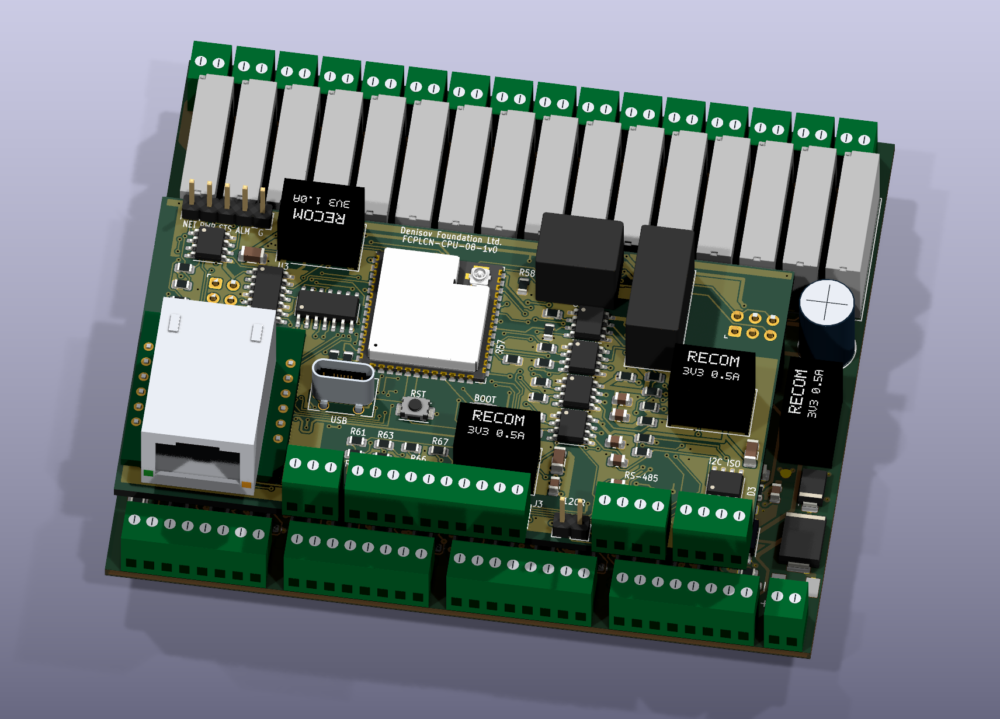
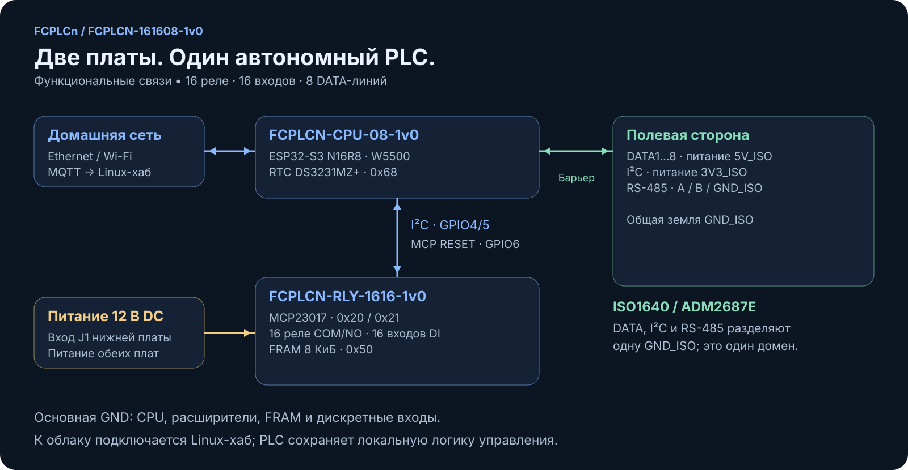
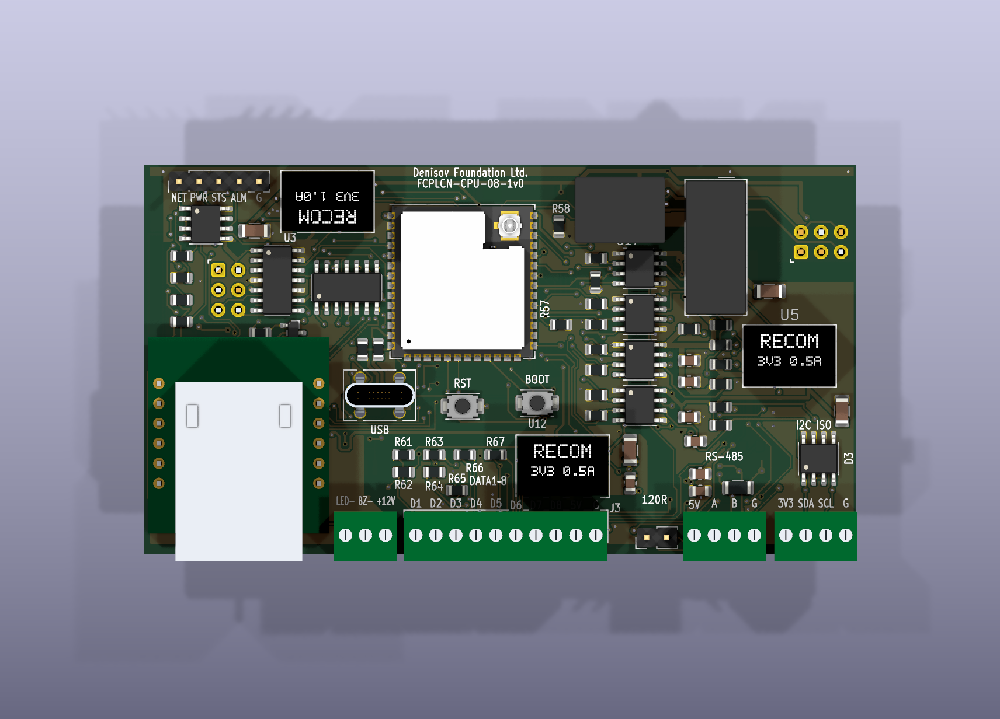
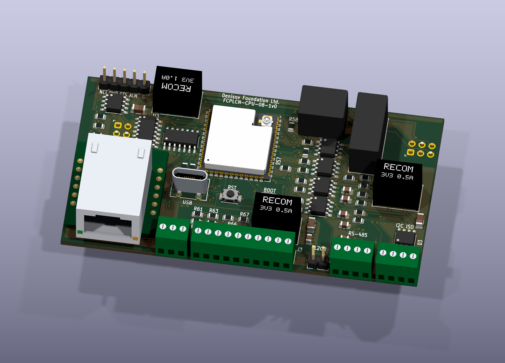
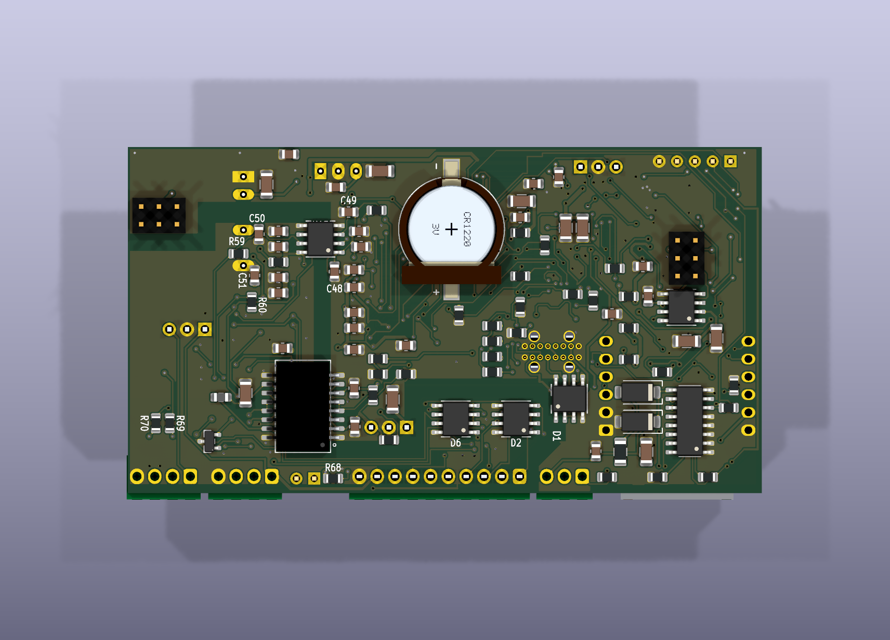
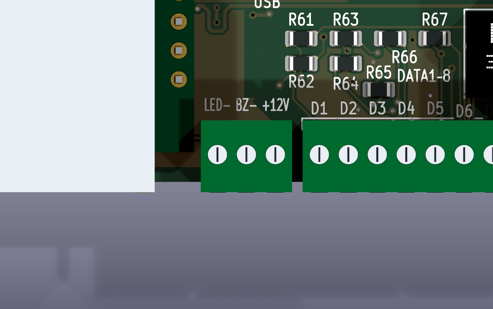
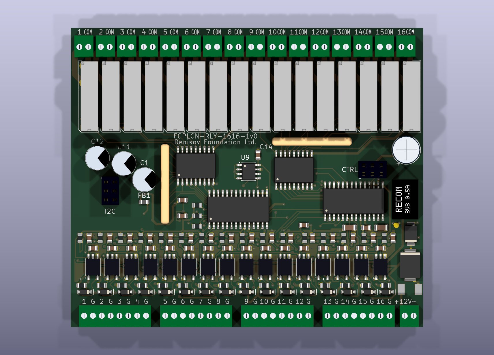
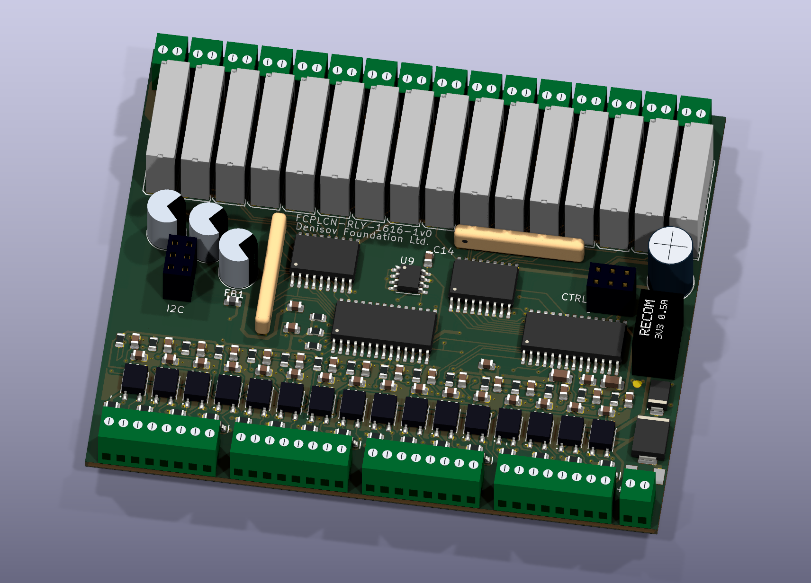
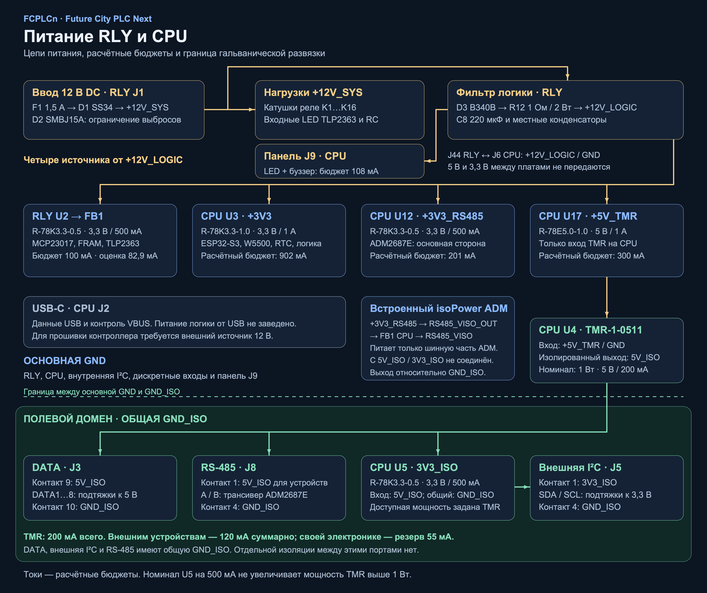

# FCPLCn — платы контроллера

**Future City PLC Next · FCPLCN-161608-1v0**

**16 реле · 16 дискретных входов · 8 DATA-линий · Ethernet · Wi-Fi · RS-485 · iButton LED/звук**

Двухплатный PLC для локальной автоматики квартиры, частного дома и дачи.
Верхняя плата содержит процессор, сетевые интерфейсы, часы и полевые порты.
Нижняя — реле, входы, расширители GPIO, энергонезависимую FRAM и вход питания.
Прошивка выполняет местную логику управления, а Linux-хаб объединяет несколько PLC
в общий умный дом.

[](docs/readme/stack-overview.png)

<p align="center">
  <a href="#overview">Характеристики</a> ·
  <a href="#cpu">CPU-плата</a> ·
  <a href="#relay">Реле и входы</a> ·
  <a href="#ports">Разъёмы и GPIO</a> ·
  <a href="#ibutton">iButton-панель</a> ·
  <a href="#power">Питание</a> ·
  <a href="#schematics">Схемы</a> ·
  <a href="#files">Файлы проекта</a>
</p>

Рендеры показывают конструкцию комплекта. Характеристики ниже сверены с текущими
схемами, нетлистами и BOM; токи обозначены как расчётные бюджеты.
Подробная аппаратная квалификация образца остаётся отдельным этапом.

Для тестового устройства предыдущего поколения **FCPLC-080806-3v1** также добавлены
[исправленная PDF-схема и сведения о подключении EEPROM](FCPLC-080806-3v1/README.md).
Его профиль в прошивке использует 8 реле, 8 входов и EEPROM 24LC512 вместо FRAM.

<a id="overview"></a>

## Комплект FCPLCN-161608-1v0

| Узел              | Исполнение                                                               |
| ----------------- | ------------------------------------------------------------------------ |
| Верхняя плата     | **FCPLCN-CPU-08-1v0**, 90,5 × 49,44 мм                                     |
| Нижняя плата      | **FCPLCN-RLY-1616-1v0**, 101 × 86 мм                                     |
| Процессор         | ESP32-S3-WROOM-1U-N16R8, внешняя антенна 2,4 ГГц                         |
| Память процессора | 16 МиБ Flash и 8 МиБ PSRAM                                               |
| Релейные выходы   | 16 независимых нормально разомкнутых пар **COM/NO**                      |
| Дискретные входы  | 16 входов для сухого контакта с TLP2363 и RC-фильтрами                   |
| DATA              | 8 линий через ISO1640 для интерфейсов с открытым стоком                  |
| Сеть              | Wi-Fi ESP32-S3 и Ethernet на W5500-Lite / USR-ES1                        |
| RS-485            | ADM2687EBRIZ, полудуплекс, управление направлением через GPIO            |
| iButton-панель    | J9: LED− / BZ− через ULN2001 и общий защищённый +12V                    |
| Часы              | DS3231MZ+, резервирование от **CR1220 3 В**                              |
| FRAM              | FM24CL64B-GTR, **8192 байта**, на нижней плате                           |
| Питание комплекта | Внешние **12 В DC**, ввод на нижней плате                                |
| Технология PCB    | Обе платы двухслойные, толщина 1,6 мм                                    |
| Спецификация      | CPU **164** + RLY **248** = **412** покупных деталей; батарейка отдельно |

Числа `16 / 16 / 08` в обозначении комплекта соответствуют реле, дискретным входам
и DATA-линиям. Это одна аппаратная конфигурация с двумя физическими платами.

### Как связаны платы

[](docs/readme/hardware-architecture.svg)

Внутренняя I²C соединяет ESP32-S3, два MCP23017, FRAM и RTC. Отдельная линия
сбрасывает расширители GPIO. Межплатные разъёмы передают защищённые 12 В и GND; местные 5 В и 3,3 В между платами не передаются.
Внешние DATA, I²C и RS-485 отделены от основной логики барьером, но используют
**общую `GND_ISO`**. Дискретные входы относятся к основной GND.

<a id="cpu"></a>

## Верхняя плата — FCPLCN-CPU-08-1v0

CPU-плата отвечает за автономную логику PLC, подключение к локальной сети,
чтение полевых датчиков и сервисный USB. ESP32-S3 установлен в исполнении
с разъёмом внешней антенны. W5500 подключён по SPI; разъём RJ45 расположен
у переднего края сборки.

[](docs/readme/cpu-top.png)

[](docs/readme/cpu-angled.png)

На обратной стороне находятся RTC, держатель батарейки и часть обвязки:

[](docs/readme/cpu-bottom.png)

| Обозначение  | Компонент                | Назначение                                     |
| ------------ | ------------------------ | ---------------------------------------------- |
| U1           | ESP32-S3-WROOM-1U-N16R8  | Контроллер, Wi-Fi, Flash и PSRAM               |
| U2           | W5500-Lite / USR-ES1     | Проводной Ethernet по SPI                      |
| U3           | R-78K3.3-1.0             | Основное питание CPU 3,3 В                     |
| U4           | TMR-1-0511               | Изолированное питание 5 В, всего 1 Вт          |
| U5           | R-78K3.3-0.5             | Полевое питание `3V3_ISO`                      |
| U6/U8/U9/U15 | ISO1640BDR               | Восемь DATA-линий, по две на микросхему        |
| U7           | ISO1640BDR               | Внешняя I²C на J5                              |
| U10 / BT1    | DS3231MZ+ / Q&J CR1220-2 | Часы и резервная батарейка                     |
| U11          | ADM2687EBRIZ             | Изолированный трансивер RS-485                 |
| U12          | R-78K3.3-0.5             | Отдельное основное питание RS-485 3,3 В        |
| U13/U14      | Nexperia 74LVC125AD,118  | Буферы сигналов между основными цепями питания |
| U16          | ULN2001D1013TR          | Управляемые минусы LED и буззера iButton-панели |
| U17          | R-78E5.0-1.0            | Местные 5 В для входа TMR, от защищённых 12 В |

### DATA и внешняя I²C

J3 выводит восемь DATA-линий, питание `5V_ISO` и `GND_ISO`. Это линии
с открытым стоком: в аппаратном профиле они соответствуют `sens-0/1`…`sens-0/8`.
Они предусмотрены для трёхпроводных OneWire/DHT22-подключений с отдельным питанием.
Полевые подтяжки DATA подключены к **5 В**.

J5 — отдельная внешняя I²C: `3V3_ISO`, SDA, SCL, `GND_ISO`.
Её сигналы подтянуты к **3,3 В**. Она использует другую пару GPIO, чем внутренняя
шина расширителей и памяти. Устройства на J5 не занимают адреса внутренней I²C.

### RS-485

J8 содержит `5V_ISO`, A/D+, B/D− и `GND_ISO`. GPIO48 управляет направлением:
HIGH — передача, LOW — приём. Терминатор **120 Ом** включается перемычкой JP2,
расположенной спереди между J3 и J8 рядом с надписью `120R`.

Питание 5 В на J8 поступает от общего полевого TMR. Внутренний источник isoPower
ADM2687E обслуживает сам трансивер и не является источником питания DATA/I²C.
Конкретный протокол RS-485 задаётся программным обеспечением; наличие трансивера
не означает автоматическую поддержку любого протокола.

<a id="ibutton"></a>

### Индикация и звук iButton-панели

**J9 — трёхконтактный KF128-2.54-3P** на нижнем переднем краю CPU-платы,
между Ethernet и DATA. Ввод проводов направлен наружу. На рендере сверху
контакты идут слева направо:

| Контакт J9 | Надпись на плате | Подключение панели | Управление |
| ---------- | ---------------- | ------------------ | ---------- |
| 1 | **LED−** | Катод светодиода | GPIO43, HIGH — включён |
| 2 | **BZ−** | Минус буззера | GPIO45, HIGH — включён |
| 3 | **+12V** | Анод LED и плюс буззера | Общая защищённая ветка питания |

[](docs/readme/ibutton-output.png)

Выходы LED− и BZ− замыкают нагрузку на основную GND через
**ULN2001D1013TR, SOIC-16, шаг 1,27 мм**. Драйвер U16 и основная обвязка
расположены на обратной стороне CPU-платы под W5500.

Для голого светодиода на плате предусмотрен R75 **1 кОм / 0,5 Вт, 0805**:
анод LED подключается к +12V, катод — к LED−. Ожидаемый ток около 6–8 мА.
Буззер подключается плюсом к +12V, минусом к BZ−; расчётная нагрузка —
до 100 мА. Для активного буззера достаточно ON/OFF, пассивный требует частотного
сигнала в прошивке. Точный тип и рабочее напряжение проверяются на реальном буззере.

Питание панели проходит через PTC, SS14 и местные 22 мкФ + 100 нФ;
SMAJ15A ограничивает выбросы, COM драйвера подключён к этой же ветке.
«12V» означает номинальную 12-вольтовую систему: при полной расчётной нагрузке
с учётом потерь на фильтре, диоде, PTC и ULN на буззере возможно около 8,5–9 В.

GPIO43 подтянут к основной GND через R73 10 кОм. R74 10 кОм подключён к базе
буззера; GPIO45 подтянут через R72 + R74, всего 10,68 кОм, когда вывод высокоимпедансный.
GPIO45 является загрузочным: LOW сохраняет 3,3 В VDD_SPI при штатных eFuse ESP32-S3.
GPIO43 может активно управляться ROM UART0 TX до настройки приложением; подтяжка
не подавляет этот сигнал, поэтому LED может мигать или гореть при загрузке.
Для постоянных логов предусмотрена USB-консоль.

**Сам сокет ключа iButton подключается отдельно к выбранной линии DATA на J3
и GND_ISO.** J9 обслуживает только свет и звук; отдельного GND на нём нет.
Контакты сокета не следует соединять с цепями LED/буззера и основной GND внутри панели.

### RTC и USB

DS3231MZ+ находится на внутренней I²C по адресу **`0x68`**. Батарейка —
**CR1220 3 В**, держатель Q&J CR1220-2, LCSC C70381; покупается отдельно.
FRAM имеет самостоятельное энергонезависимое хранение и батарейки не требует.

USB-C J2 используется для штатного USB Serial/JTAG ESP32-S3. D−/D+ подключены
к GPIO19/20, VBUS контролируется через GPIO21. **Для работы и прошивки через USB
нужно штатное питание 12 В:** USB VBUS служит сигналом контроля и не питает платы.
На плате доступны кнопки RESET и BOOT.

<a id="relay"></a>

## Нижняя плата — FCPLCN-RLY-1616-1v0

Нижняя плата объединяет шестнадцать реле, шестнадцать дискретных входов,
два MCP23017, FRAM и питание всего комплекта. Верхний ряд клемм — выходные
контакты реле, нижний — входы DI с соседними GND; справа расположен ввод 12 В.

[](docs/readme/relay-top.png)

[](docs/readme/relay-angled.png)

### Реле

K1…K16 — **HF49FD/012-1H11** с катушками 12 В. Каждый канал имеет свою пару
COM/NO на отдельном клеммнике J2…J17. Силовые COM разных каналов внутри платы
не объединены. U3/U4 **TBD62083AFWG** управляют катушками, а RN1/RN2 задают
подтяжки управляющих линий к GND.

```text
Реле выключено:  COM  o     o  NO
Реле включено:   COM  o─────o  NO

MCP23017 → TBD62083AFWG → катушка K1…K16
```

При сборке допустимая нагрузка определяется всем трактом: контактами выбранного
реле, дорожками, клеммами и проводкой. Число каналов не задаёт допустимый ток
силовой части.

### Дискретные входы

J21/J25/J29/J33 принимают четыре группы по четыре сухих контакта.
У каждого DI рядом расположен GND. Состояния на стороне MCP23017:

| Контакт между DI и GND | Уровень входа |
| ---------------------- | ------------- |
| Разомкнут              | **HIGH**      |
| Замкнут                | **LOW**       |

[](docs/readme/input-channel.svg)

Каждый канал содержит TLP2363, входной TVS, обратный диод и две ступени фильтрации.
В текущей ревизии входная цепь использует **1,2 кОм**, последовательные **220 Ом**,
ёмкость **1 мкФ** и шунт LED **4,7 кОм**. На выходе остаются **470 Ом / 100 нФ**
и внешняя подтяжка RAW-сигнала **10 кОм**. Внутренние подтяжки MCP23017 отключены.

Цепь LED питается от внутренних 12 В. DI рассчитан на замыкание сухим контактом;
его нельзя трактовать как свободный GPIO 3,3 В. **Земля DI общая с логикой**:
TLP2363 здесь не образуют отдельный гальванически изолированный домен входов.
Примеры назначений — возвратная кнопка, геркон или релейный выход датчика.

### Расширители и FRAM

U5/U6 **MCP23017** обслуживают по восемь реле и восемь входов.
Обозначения портов MCP повторяются на каждой микросхеме:

| Номер в группе | Реле      | Дискретный вход |
| -------------- | --------- | --------------- |
| 1…7            | GPA1…GPA7 | GPB0…GPB6       |
| 8              | GPB7      | GPA0            |

U5 соответствует каналам **1…8**, U6 — **9…16**. Маска выходов — `0x80FE`,
входов — `0x7F01`. Аппаратный RESET расширителей приходит с CPU GPIO6;
INTA/INTB не подключены.

U9 **FM24CL64B-GTR** хранит 8192 байта без питания. A0/A1/A2 подключены к GND,
поэтому адрес — `0x50`; WP также на GND, запись разрешена. Память подключена
к той же внутренней шине, что расширители и RTC. В прошивке она используется
для сохранения оперативных состояний оборудования.

| Внутренняя I²C · GPIO4/5 | Адрес, 7 бит | Размещение                |
| ------------------------ | ------------ | ------------------------- |
| MCP23017 U5              | `0x20`       | Нижняя плата, каналы 1…8  |
| MCP23017 U6              | `0x21`       | Нижняя плата, каналы 9…16 |
| FRAM FM24CL64B-GTR U9    | `0x50`       | Нижняя плата              |
| RTC DS3231MZ+ U10        | `0x68`       | Верхняя плата             |

<a id="ports"></a>

## Разъёмы и аппаратные имена

**Нумерация ниже — номера контактов в KiCad**, а не направление слева направо
на произвольно повёрнутом рендере. Первый контакт сверяется по исходнику и
маркировке конкретного разъёма.

| Плата / разъём | Назначение         | Контакты по номерам                                     |
| -------------- | ------------------ | ------------------------------------------------------- |
| RLY · J1       | Питание комплекта  | 1 — +12 В DC; 2 — GND                                   |
| RLY · J2…J17   | Реле 1…16          | 1 — COM; 2 — NO                                         |
| RLY · J21      | Входы 1…4          | Нечётные 1/3/5/7 — DI1/2/3/4; чётные — GND              |
| RLY · J25      | Входы 5…8          | Нечётные 1/3/5/7 — DI5/6/7/8; чётные — GND              |
| RLY · J29      | Входы 9…12         | Нечётные 1/3/5/7 — DI9/10/11/12; чётные — GND           |
| RLY · J33      | Входы 13…16        | Нечётные 1/3/5/7 — DI13/14/15/16; чётные — GND          |
| CPU · J3       | DATA, 10 контактов | 1…8 — DATA1…8; 9 — 5V_ISO; 10 — GND_ISO                 |
| CPU · J5       | Внешняя I²C        | 1 — 3V3_ISO; 2 — SDA_ISO; 3 — SCL_ISO; 4 — GND_ISO      |
| CPU · J8       | RS-485             | 1 — 5V_ISO; 2 — A/D+; 3 — B/D−; 4 — GND_ISO             |
| CPU · J9       | iButton LED / звук | 1 — LED−; 2 — BZ− (BUZZER−); 3 — +12V панели             |
| CPU · J7       | Передняя индикация | 1 — NET; 2 — PWR; 3 — STATUS; 4 — ALARM; 5 — GND        |
| CPU · J2       | Сервисный USB-C    | USB D−/D+, VBUS sense; внешнее питание 12 В сохраняется |

### Две штатные межплатные пары

Нижние гнёзда — Samtec **SSW-103-01-L-D**, верхние гребёнки —
**TSW-103-07-L-D**. У каждой пары шесть контактов, всего между платами их двенадцать.

| Контакт | Нижний J43 ↔ верхний J1 | Нижний J44 ↔ верхний J6 |
| ------- | ----------------------- | ----------------------- |
| 1       | GND                     | GND                     |
| 2       | GND                     | GND                     |
| 3       | GND                     | +12V_LOGIC              |
| 4       | GND                     | +12V_LOGIC              |
| 5       | I2C_SDA, GPIO4          | MCP_RESET_N, GPIO6      |
| 6       | I2C_SCL, GPIO5          | GND                     |

Обозначения J1 и J6 здесь относятся к CPU; RLY J1 — отдельный ввод питания.
В текущей CAD-ревизии дополнительных механических пар разъёмов нет.

### GPIO ESP32-S3

| Назначение                   | GPIO                             |
| ---------------------------- | -------------------------------- |
| Внутренняя I²C SDA / SCL     | **4 / 5**                        |
| RESET MCP23017               | **6**                            |
| W5500 CS / SCK / MOSI / MISO | **9 / 10 / 11 / 12**             |
| W5500 INT_N / RESET_N        | **13 / 14**                      |
| USB D− / D+ / VBUS sense     | **19 / 20 / 21**                 |
| RS-485 TX / RX / DIR         | **8 / 47 / 48**                  |
| Внешняя I²C SDA / SCL        | **41 / 42**                      |
| DATA1…DATA8                  | **39, 40, 17, 18, 1, 2, 38, 44** |
| NET / STATUS / ALARM         | **7 / 15 / 16**, активный LOW    |
| iButton LED / BUZZER         | **43 / 45**, HIGH включает нагрузку |
| BOOT                         | **0**                            |

PWR показывает основное питание 3,3 В. GPIO35–37 оставлены неподключёнными
для варианта N16R8 с Octal PSRAM. GPIO44 уже используется DATA8. GPIO43/45 заняты панелью; на них установлены внешние подтяжки к GND. GPIO3 оставлен NC.

В профиле прошивки каналы имеют имена `rly-0/1`…`rly-0/16`,
`in-0/1`…`in-0/16` и `sens-0/1`…`sens-0/8`.
[Профиль аппаратуры в fcplcn-soft](https://github.com/LittleBuster/fcplcn-soft/blob/main/firmware/base/main/hardware/board_profile.cpp).

<a id="power"></a>

## Питание и домены земли

[](docs/readme/power-domains.svg)

[Открыть схему питания SVG](docs/readme/power-domains.svg).
Ниже **CPU** означает верхнюю плату, **RLY** — нижнюю; одинаковые номера
компонентов на разных платах обозначают разные детали.

### Ввод 12 В и ветка логики

Питание приходит на **RLY J1**: `+12V / GND`. Последовательные
**F1 Littelfuse 045201.5MRL, 1,5 А** и **D1 SS34** ведут к `+12V_SYS`.
D1 блокирует обратную полярность в этой ветке; **D2 SMBJ15A** подключён
между `+12V_SYS` и GND для ограничения кратковременных выбросов.
C1/C11/C12 образуют накопительный банк **300 мкФ / 35 В**.

От `+12V_SYS` питаются **катушки 16 реле** и **светодиодные входные цепи
TLP2363**. Сухие COM/NO контакты реле электрически отделены от катушек:
напряжение коммутируемой нагрузки подаётся на них извне.

Ветка электроники идёт отдельно:
`+12V_SYS → D3 B340B → +12V_LOGIC_RAW → R12 1 Ом → +12V_LOGIC`.
**C8 220 мкФ / 35 В** и **C13 100 нФ** подключены после R12.
D3 отделяет накопленную энергию этой ветки от катушек, а R12/C8/C13
образуют фильтр питания логики. Из-за падений на диодах и R12
`+12V_LOGIC` ниже напряжения внешнего блока питания.

### Четыре местных преобразователя

Все четыре получают `+12V_LOGIC` и работают относительно основной **GND**.
Модули **R-78 — импульсные стабилизаторы без гальванической изоляции**.

| Плата и источник | Выход и его потребители | Номинал модуля | Выделенный расчётный ток |
| --- | --- | --- | --- |
| **RLY U2, R-78K3.3-0.5** | `+3V3_DCDC → FB1 → +3V3`: MCP23017, FRAM, выходные стороны TLP2363 и их обвязка | **3,3 В / 500 мА** | **100 мА**; компонентная оценка **82,9 мА** |
| **CPU U3, R-78K3.3-1.0** | Основные `+3V3`: ESP32-S3, W5500, RTC, основные стороны ISO1640, индикация и обвязка | **3,3 В / 1 А** | **902 мА** |
| **CPU U12, R-78K3.3-0.5** | `+3V3_RS485`: основная сторона ADM2687E, локальный буфер и подтяжки | **3,3 В / 500 мА** | **201 мА** |
| **CPU U17, R-78E5.0-1.0** | Местные `+5V_TMR`: только вход изолированного TMR U4 | **5 В / 1 А** | **300 мА** |

Нижний **FB1 — Murata BLM21PG221SN1D**, ферритовый фильтр с малым
сопротивлением постоянному току. C3/C6 находятся до него, C7 и местные
100 нФ микросхем — после. Нижнего линейного стабилизатора U8 больше нет.
Обе платы имеют собственные 3,3 В; **их выходы между собой не соединены**.

Между платами питание передаётся только как **`+12V_LOGIC` и GND**:
справа J44/J6 контакты **3/4 — +12V_LOGIC**, **1/2/6 — GND**, **5 — RESET MCP**.
Слева J43/J1 контакты **1–4 — GND**, **5/6 — SDA/SCL**.
Местные 5 В и 3,3 В через межплатные разъёмы не проходят.

### Питание датчиков и полевой стороны

На CPU цепочка начинается с **U17**:
`+12V_LOGIC → +5V_TMR → U4 TMR-1-0511 → +5V_ISO / GND_ISO`.
**TMR обеспечивает гальваническую развязку питания**. Его выход 5 В
питает полевые стороны DATA-изоляторов, контакт **9 J3** и контакт **1 J8**.
От той же `+5V_ISO` **U5 R-78K3.3-0.5** формирует `+3V3_ISO`
для внешней I²C, включая контакт **1 J5** и полевую сторону её изолятора.
U5 сохраняет домен `GND_ISO`, а собственной изоляции не добавляет.

| Полевая ветка | Номинал / принятый бюджет |
| --- | --- |
| Выход **U4 TMR-1-0511** | **5 В / 200 мА, всего 1 Вт** |
| Собственная полевая электроника | **55 мА** резерва в эквиваленте нагрузки 5 В |
| Все внешние DATA/I²C/RS-485 устройства вместе | **120 мА** суммарного проектного лимита |
| Полевая ветка вместе | **175 мА** бюджета на выходе TMR, **25 мА** резерва |
| Выход **U5 R-78K3.3-0.5** | Номинал **3,3 В / 500 мА**; доступную мощность ограничивает общий TMR |

**120 мА — общий лимит всех внешних устройств, а не каждого порта или каждой
шины питания.** Нагрузку 3,3 В учитывают также по её потреблению от 5 В
с потерями U5. Номинал U5 500 мА и номинал U17 1 А не увеличивают мощность
полевого источника выше 1 Вт.

У **ADM2687E U11** есть отдельный внутренний **isoPower**:
`VISOOUT, вывод 10 → CPU FB1 → VISOIN, вывод 15`.
Он питает только шинную сторону самого ADM и **не объединён с `+3V3_ISO`**.
Контакт питания J8 получает 5 В от TMR, а не от isoPower.
При этом земля шинной стороны ADM, DATA и внешней I²C общая — **GND_ISO**;
отдельной изоляции между этими портами нет.

### Панель, часы и USB

LED/буззер iButton-панели питаются по основной ветке:
`+12V_LOGIC → CPU F2 PTC → D11 SS14 → +12V_PANEL → J9`.
Местные C52/C53 и TVS D12 находятся в этом же домене, ULN2001 замыкает
LED−/BZ− на основную GND. Выделено **108 мА**: до **100 мА** буззеру
и **8 мА** LED. Обозначение «12V» номинальное; при полной расчётной нагрузке
с учётом последовательных потерь на буззере ожидается около **8,5–9 В**.
Сокет ключа DATA/GND_ISO подключается отдельно от света и звука.

RTC питается от основных 3,3 В CPU через R46. **CR1220** резервирует только
часы DS3231MZ+, не CPU и не остальную плату; зарядной цепи батарейки нет.
FRAM хранит данные без питания и батарейку не использует.

**USB VBUS — только контроль наличия USB через GPIO21.** Он не питает
ни CPU, ни RLY и не соединён с местной `+5V_TMR`.
Для работы и прошивки через USB-C требуется внешнее питание **12 В**.

Токи в таблицах — проектные выделения, а не измеренные максимумы.
Для входа TMR при полной мощности 1 Вт и типовом КПД 76% получается
**263,158 мА при 5 В**; выделено 300 мА. Текущая модель всего комплекта
с одновременными нагрузками даёт около **0,995–1,012 А от 12 В**.
Условия, КПД и температурные допущения:
[Power-budget.json](FCPLCN-161608-1v0/Power-budget.json),
[расчёт раздельного питания](FCPLCN-161608-1v0/Power-split-design-review.json).
Реальные пусковые токи, пульсации и нагрев проверяются на образце.

**Основная GND** объединяет CPU, MCP23017, FRAM, RTC и дискретные входы.
**GND_ISO** объединяет DATA, внешнюю I²C и полевую сторону RS-485.
Изоляция между этими доменами сохраняется при соответствующем внешнем подключении.

<a id="schematics"></a>

## Принципиальные схемы и разводка

Полные схемы экспортированы из текущих KiCad-исходников. В README приведены
предпросмотры; для чтения номиналов и трассировки цепей откройте SVG или PDF
в полном масштабе. Версия экспортёра, исходные SHA-256 и состав файлов записаны
в [манифесте](docs/schematics/manifest.json).

### CPU: процессор, сеть, RTC и полевые интерфейсы

[](docs/schematics/cpu-schematic.svg)

**[SVG](docs/schematics/cpu-schematic.svg) · [PDF](docs/schematics/cpu-schematic.pdf) ·
[исходник KiCad](FCPLCN-161608-1v0/FCPLCN-CPU-08-1v0/FCPLCN-CPU-08-1v0.kicad_sch)**

### RLY: питание, реле, входы, MCP23017 и FRAM

[](docs/schematics/relay-schematic.svg)

**[SVG](docs/schematics/relay-schematic.svg) · [PDF](docs/schematics/relay-schematic.pdf) ·
[исходник KiCad](FCPLCN-161608-1v0/FCPLCN-RLY-1616-1v0/FCPLCN-RLY-1616-1v0.kicad_sch)**

### CPU: верхняя и нижняя стороны

[](docs/schematics/cpu-pcb.svg)

[](docs/schematics/cpu-pcb-bottom.svg)

Нижний вид показан со стороны нижних компонентов, с зеркальным отображением.
Схемы и виды пересоздаются командой `./tools/export-readme-schematics.sh`;
требования и форматы описаны в [инструкции экспортов](docs/schematics/README.md).

## Механика и сборка

Две платы устанавливаются стеком. По текущей модели межплатный зазор —
**11,05 мм**, верхняя поверхность CPU расположена на **12,65 мм** выше верхней
поверхности нижней платы. Толщина каждой PCB — **1,6 мм**.
Геометрия разъёмов и расстояния сохранены в
[Stack-mechanics.json](FCPLCN-161608-1v0/Stack-mechanics.json).

При открытии проекта сохраните папки локальных библиотек и 3D-моделей рядом
с соответствующей платой: относительные пути используют `${KIPRJMOD}`.
Нужны стандартные библиотеки **KiCad 10**. Геометрические модели служат для
проверки компоновки; конкретные модули, держатель батарейки и межплатные соединители
сверяются с выбранными покупными деталями.

### Первый запуск комплекта

1. Проверьте распиновку и полярность, подайте штатные 12 В на RLY J1.
2. Проверьте основные 5 В и 3,3 В, затем `5V_ISO` / `3V3_ISO` относительно `GND_ISO`.
3. Подключите сервисный USB-C с сохранённым питанием 12 В и загрузите прошивку
   для профиля `fcplcn-161608-1v0` из репозитория софта.
4. Подключите PLC к локальной сети и настройте адрес MQTT-хаба через сервисный веб.
5. Проверяйте реле, входы и датчики по одному, учитывая аппаратные имена каналов.

В [актуальном отчёте CAD](FCPLCN-161608-1v0/Power-split-validation.json)
приведены результаты ERC, проверки соединений, производственных зазоров,
изоляции и механики. У CPU сохраняются **два документированных механических
исключения DRC** для держателя батарейки. Предупреждения о локальной шелкографии
посадочных мест оставлены видимыми; площадки, сверловка и модели проверяются отдельно.
Контрольные суммы схем и плат в отчёте позволяют проверить, к какой ревизии
относятся результаты. Электрические расчёты и CAD-проверки не заменяют измерения
потребления, запусков питания и помех на физической сборке.

<a id="files"></a>

## Что находится в репозитории

```text
fcplcn-boards/
├── README.md                       описание комплекта и подключений
├── docs/
│   ├── readme/                     рендеры плат, крупный план J9 и функциональные SVG
│   └── schematics/                 схемы PDF/SVG/PNG и виды CPU
├── tools/                          воспроизведение иллюстраций README
└── FCPLCN-161608-1v0/
    ├── FCPLCN-CPU-08-1v0/           верхняя плата, KiCad, библиотеки и модели
    ├── FCPLCN-RLY-1616-1v0/         нижняя плата, KiCad, библиотеки и модели
    ├── BOM-combined.csv             общая ведомость компонентов
    ├── ASSEMBLY.md                  проектные заметки по сборке и изменениям
    ├── Power-budget.json            текущая модель питания
    ├── Support-removal-validation.json  проверка текущих исходников
    ├── Previews/native-all-views/    галерея ракурсов
    └── tools/                       аппаратные проверки и подготовка видов
```

| Материал                    | Ссылка                                                                                                                   |
| --------------------------- | ------------------------------------------------------------------------------------------------------------------------ |
| Проект CPU                  | [KiCad .kicad_pro](FCPLCN-161608-1v0/FCPLCN-CPU-08-1v0/FCPLCN-CPU-08-1v0.kicad_pro)                                      |
| Проект RLY                  | [KiCad .kicad_pro](FCPLCN-161608-1v0/FCPLCN-RLY-1616-1v0/FCPLCN-RLY-1616-1v0.kicad_pro)                                  |
| Общий BOM                   | [BOM-combined.csv](FCPLCN-161608-1v0/BOM-combined.csv)                                                                   |
| Схемы для чтения            | [PDF/SVG/PNG](docs/schematics/README.md)                                                                                 |
| Архив KiCad-проекта         | [FCPLCN-161608-1v0-KiCad.zip](FCPLCN-161608-1v0/FCPLCN-161608-1v0-KiCad.zip)                                             |
| Архив 3D-видов              | [FCPLCN-161608-1v0-3D-views.zip](FCPLCN-161608-1v0/FCPLCN-161608-1v0-3D-views.zip)                                       |
| Галерея                     | [Индекс ракурсов](FCPLCN-161608-1v0/Previews/native-all-views/index.html) — HTML можно открыть локально после скачивания |
| Заметки сборки              | [ASSEMBLY.md](FCPLCN-161608-1v0/ASSEMBLY.md)                                                                             |
| История аппаратных операций | [CHANGELOG.md](FCPLCN-161608-1v0/CHANGELOG.md)                                                                           |
| Проверки и инструменты      | [tools/README.md](FCPLCN-161608-1v0/tools/README.md)                                                                     |

Старые отчёты и разделы заметок содержат номиналы и количества деталей своих
ревизий. Для текущего комплекта используются **412 деталей**, современные
входные RC-цепи и контрольные суммы из актуального отчёта; история сохранена отдельно.

Превью README обновляются из проверенных рендеров KiCad командой
`python3 tools/update_readme_previews.py`. Источники и SHA-256 изображений
сохраняются в [манифесте превью](docs/readme/preview-manifest.json).

## Прошивка, хаб и облако

Программная часть находится в отдельном публичном репозитории
**[LittleBuster/fcplcn-soft](https://github.com/LittleBuster/fcplcn-soft)**:
прошивка ESP-IDF/C++, сервисный веб PLC, локальный хаб и собственное облако.
Внешний доступ проходит через хаб, а местные контуры управления исполняются на PLC.

Для продолжения:
[описание программной платформы](https://github.com/LittleBuster/fcplcn-soft#readme) ·
[аппаратный профиль](https://github.com/LittleBuster/fcplcn-soft/blob/main/firmware/base/main/hardware/board_profile.cpp) ·
[сборка и прошивка](https://github.com/LittleBuster/fcplcn-soft/blob/main/tools/firmware/README.md).
